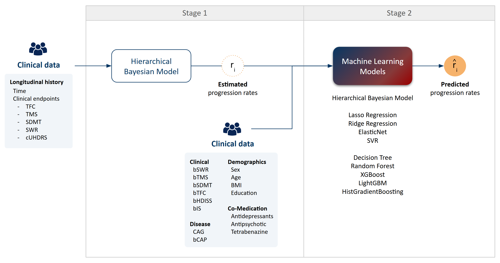

# PROCOVA for Huntington's Disease

Prognostic covariate adjustment pipeline for Huntington's Disease clinical trial design.

This pipeline trains machine learning models on longitudinal data to predict individual disease progression rates, which can then be used as prognostic covariates in clinical trial analysis frameworks (e.g., MMRM) to improve statistical power.

## Method

**Stage 1 — Hierarchical Bayesian Model (HBM):**
Fits a random-slope linear mixed model via MCMC (PyMC/NumPyro) to extract per-patient progression rates (beta) from longitudinal clinical scores.

**Stage 2 — Machine Learning Models:**
Trains 9 supervised regressors (Lasso, Ridge, ElasticNet, SVR, Decision Tree, Random Forest, XGBoost, LightGBM, HistGradientBoosting) plus a full Bayesian model to predict beta from baseline covariates. Hyperparameters are tuned via Optuna with precision-weighted cross-validation.



## Quick start

```bash
# Install dependencies
pip install -e .
# or with uv:
uv sync

# Generate simulated data
python scripts/generate_data.py

# Run cross-validation (fold 1 of 100)
python scripts/train_cv.py 1

# Train final models on all training data
python scripts/train_final.py
```

## Project structure

```
hd-procova/
├── src/
│   ├── config.py        # Model registry, hyperparameter spaces, global config
│   ├── simulate.py      # Simulated longitudinal data generation
│   ├── data.py          # Data loading, scaling, preprocessing
│   ├── hbm.py           # Hierarchical Bayesian Model (PyMC/MCMC)
│   └── ml.py            # ML training, Optuna tuning, feature importance
├── scripts/
│   ├── generate_data.py # Generate simulated train/test datasets
│   ├── train_cv.py      # 10x10 repeated cross-validation pipeline
│   └── train_final.py   # Final model training on full data
├── notebooks/
│   └── figures.ipynb    # Result visualizations
└── data/                # Generated data (gitignored)
```

## Data simulation

The simulated data mimics the structure of longitudinal clinical trial data:
- `n` individuals with varying numbers of follow-up visits
- Baseline score (`x0`) and longitudinal scores (`x`)
- 50 baseline covariates: 20 with true prognostic effects, 30 irrelevant
- Individual progression rates driven by covariates + random effects + noise

```python
from src.simulate import create_simulated_dataset
df = create_simulated_dataset(n_individuals=1000)
```

## Pipeline details

### Cross-validation (`train_cv.py`)

Implements 10x10 repeated cross-validation (10 repetitions of 10-fold outer CV). Each fold:
1. Splits patients into train/validation (patient-level, no leakage)
2. Fits the HBM on training patients to extract progression rates
3. Trains all ML models with Optuna hyperparameter tuning (5-fold inner CV)
4. Evaluates on held-out validation patients

```bash
# Run fold 1
python scripts/train_cv.py 1

# Run all 100 folds (e.g., via job array)
for i in $(seq 1 100); do python scripts/train_cv.py $i; done
```

### Final model (`train_final.py`)

Trains on the complete training set and evaluates on the held-out test set. Saves fitted models, scalers, and deployment artefacts.

```bash
python scripts/train_final.py
```

## Requirements

- Python >= 3.10
- PyMC >= 5.10 with NumPyro backend
- See `pyproject.toml` for full dependency list

GPU acceleration (optional): Install JAX with CUDA support for 10-20x faster MCMC sampling.
